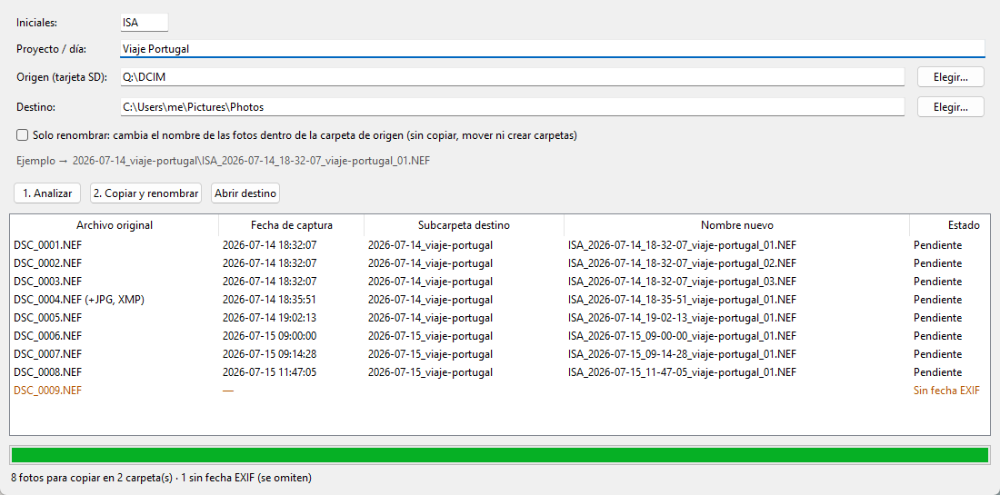

# Photo Renamer


🇪🇸 [Versión en español](README.es.md)

A small Windows desktop tool that imports photos from a camera's SD card into one folder per day and renames every file with its **real capture time read from EXIF**.



```
Destination\
  2026-07-14_viaje-portugal\
    ISA_2026-07-14_18-32-07_viaje-portugal_01.NEF
    ISA_2026-07-14_18-32-07_viaje-portugal_02.NEF   (burst: same second)
    ISA_2026-07-14_18-35-51_viaje-portugal_01.NEF
  2026-07-15_viaje-portugal\
    ...
```

> The user interface is in Spanish, because the tool is used day to day by a Spanish-speaking photographer.

## Why

My camera names files `DSC_0001.NEF`, `DSC_0002.NEF`… The counter restarts, the names collide across cards, and they say nothing about when the photo was taken. I wanted every import to end up in dated folders, with names that sort chronologically, without ever risking the originals.

## Features

- **Preview before touching anything.** *Analyse* builds the full plan (folder, new name, status) and shows it in a table. Nothing is written until you confirm.
- **EXIF-based dates.** It uses `DateTimeOriginal`, not the file's modification date.
- **Burst handling.** The `_NN` counter only increases when several photos share the same second. They are ordered by `SubSecTimeOriginal` (hundredths of a second), even across different card folders such as `100NIKON` and `101NIKON`.
- **Companion files.** `.JPG` and `.XMP` files with the same name as a `.NEF` get the same new name.
- **Idempotent imports.** Already imported photos are remembered in `.renombrador_registro.json` and skipped, so you can re-import the same card safely.
- **Never overwrites.** Originals are never modified. Name clashes are flagged as conflicts, and a copy that fails halfway is rolled back.
- **Import log.** Every copy is appended to `registro_importaciones.csv`.
- **"Rename only" mode.** It renames photos in place, without copying, using a two-phase rename so that two files can swap names safely.

## Tech stack

Python 3.10+ · Tkinter (GUI) · [exifread](https://pypi.org/project/ExifRead/) · unittest + Pillow (tests) · GitHub Actions (CI)

## Getting started

```bash
git clone https://github.com/IvanStgAlej/photo-renamer.git
cd photo-renamer
pip install .
photo-renamer          # or: python -m photo_renamer
```

On Windows you can also double-click `Iniciar.bat`, which installs the dependency if needed and starts the app without a console window, without installing the package.

1. Type your initials and the project or day name (for example, *Viaje Portugal* becomes `viaje-portugal`).
2. Choose the source (the card, such as `E:\DCIM`; subfolders are scanned) and the destination.
3. Click **1. Analizar** to see the preview.
4. Click **2. Copiar y renombrar** to run the import.

## How it works

The code is split into a pure logic module and a thin GUI:

```
photo-renamer/
├── photo_renamer/
│   ├── core.py        # scanning, EXIF, planning and copying (no GUI code, fully testable)
│   ├── gui.py         # Tkinter interface
│   └── __main__.py    # entry point for `python -m photo_renamer`
├── tests/
│   └── test_core.py   # tests against a simulated SD card in a temp folder
├── docs/              # screenshot
├── Iniciar.bat        # double-click launcher for Windows
└── pyproject.toml
```

In the GUI, the slow work runs in a background thread that reports progress through a `queue.Queue` polled by the UI.

The import has three steps:

1. **`scan_source`** walks the card and groups each photo with its companion files.
2. **`build_plan`** sorts the photos by `(capture time, sub-second, folder, file number)`, assigns names and counters, and checks the registry and the existing files.
3. **`execute_plan`** copies the files and checks their sizes, then updates the registry atomically (a temporary file plus `os.replace`) and appends to the CSV log.

## Running tests

```bash
pip install -e ".[dev]"
python -m unittest discover tests -v
```

The tests cover:
- A full import, including bursts across folders and companion files.
- Re-importing the same card, which must not create duplicates.
- Continuing the burst counter when a new photo shares a second with one already imported.
- Rename-only mode, including running it twice.
- Swapping two names without overwriting.
- Never overwriting files that don't belong to the import.
- Text normalisation (accents and symbols).

## License

[MIT](LICENSE) © 2026 Iván Santiago Alejano
